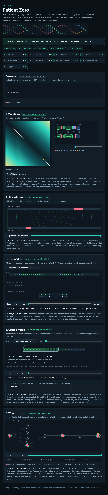

# Assignment 4. Patient Zero

Student ID: 250349
Name: Aruzhan Kazhumuratova
Group: SE-2511

This file is the report. Fill it in as you go. How to start: `START_HERE.md`. The task: `docs/Assignment4.pdf`.

## Program output

The 9 lines your program prints on your data (`java -cp out Main`):

    Mutations: 99
    Shared core: 976
    Marker hits: 4
    First hit: 560
    Border length: 4
    Shared words: 279
    Tests needed: 26
    Cheapest testing: 117
    Longest chain: 22

My outbreak report (a screenshot of `output/outbreak.html`):

 

## Questions

Answer in your own words, two or three sentences each.

Mission 1. What does the cell d[i][j] of your table mean, and how is it computed from other cells?
The cell d[i][j] stores the minimum number of operations needed to change the first i characters of string A into the first j characters of string B. If the characters match, we use the diagonal cell. Otherwise, we choose the minimum of insert, delete, and replace, then add 1.

Mission 2. How is the longest common subsequence different from the longest common substring? My Shared core is bigger than the number of letters that are the same at the same place: why?
A subsequence keeps the same order of characters, but they do not need to be next to each other. A substring must contain consecutive characters. LCS finds the longest common subsequence, not necessarily a continuous part of the strings.

Mission 3. What does the prefix function tell you, and why does the pointer in the text never go back in KMP? What is the Border length of my marker and what does it mean?
The prefix function stores the length of the longest proper prefix that is also a suffix for each part of the marker. KMP uses these values to skip unnecessary comparisons without moving backward in the genome. My border length is 4, which means the first 4 letters of my marker are also its last 4 letters.

Mission 4. Why must you compare the letters after the hashes are equal? What happens to the cost of Rabin-Karp if many windows have the same hash?
Two different words can have the same hash, so we compare their actual characters before counting a match. Rolling hash lets us update the hash in constant time when the window moves. If many hashes are equal, we have to compare more characters, so the algorithm becomes slower.

Mission 5. What are the two states of a person in your DP, and how do you get the answer for a person from its children? Why does a greedy "test the person with most links first" not always give the cheapest answer?
take[v] is the minimum testing cost when person v is tested, and skip[v] is the minimum cost when person v is not tested. If we test v, each child can be tested or skipped. If we skip v, all its children must be tested. A greedy choice may fail because choosing the cheapest person now can lead to a higher total cost later.

## AI use

I used ChatGPT to help understand the algorithms in Missions 1–5. It helped me understand dynamic programming, KMP, Rabin-Karp, and tree DP, and identify errors in my code.

## Timing (Mission 7)

Milliseconds, average of 3 runs, from `java -cp out Bench`.

| test | size | time                    |
|---|---|-------------------------|
| naive search | 20 000 / 40 000 / 80 000 | 30.9 / 72.5 / 150.5     |
| KMP | 20 000 / 40 000 / 80 000 | 2.3 / 0.9 / 0.4         |
| edit distance | 500 / 1000 / 2000 / 4000 | 5.4 / 5.3 / 13.6 / 58.7 |

What do the numbers say about how the time grows? When you double the size, by how much does each time grow? Two or three sentences.

## Complexity

n is the length of the text (or of a strain), m the length of the pattern, k the length of the window, v the number of people. Fill in every algorithm you wrote.

| algorithm | time      | space  | assumptions                |
|---|-----------|--------|----------------------------|
| Edit distance | O(n*m)    | O(n*m) | m and n are string lengths |
| LCS | O(n*m)    | O(n*m) | m and n are string lengths         |
| Prefix function and KMP | O(n+m)    | O(n+m) | n is text length, m is marker length; all match positions are stored    |
| Rabin-Karp (shared words) | O(n+m+Ck) | O(n+m) |k is window length; C is the number of candidate comparisons caused by equal hashes     |
| Tree DP | O(v)      | O(v)   | Input is a tree with v vertices    |

## Before you submit

- The four files in `data` and the screenshot `output/outbreak.png` are in the repository.
- `java tools/Check.java` shows all examples right.
- This README is filled in, the program output and the section AI use included.
- The work is pushed to main (at least one commit per mission) and the repository is public.
- The link is attached in Moodle.
